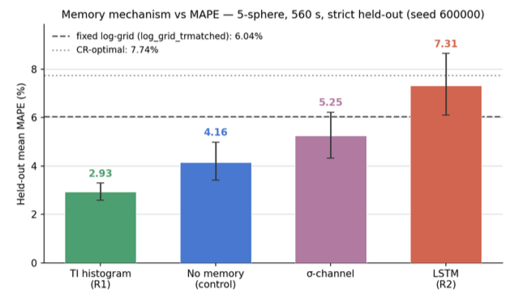

What to include:
- 

Motivation: *

Goal(s): *

Approach: *

Results: *

Introduction

Methods

- Digital twin of a calibration phantom
- Multi-fidelity RL environment

Results

- Open-source, documented library for the QalibreMD phantom digital twin (including the multi-fidelity code)
- the first reinforcement-learning agent for adaptive quantitative MRI: a policy that conditions each acquisition on the current fitted tissue parameters and is trained and evaluated directly on fitted-T1 error.
- This work we were testing can RL learn a better acquisition sequence than the Cramer-Rao lower bound (which is mathematically ideal for 1 but can't be generalised to multi pixels - where as)

Discussion/Conclusion

Statistically significant
LSTM limitation - didn't train for long enough
5 spheres - 14 was too difficult, full T1 parameter map would be better

Figures:
5 spheres - 

Okay figure wise:

# Abstract discussion

Thu, 22 Oct 26 · Andreas Wetscherek

## Conference and Submission Plan

- ISMRM chosen over MR and RT
  - Work is not MRI-radiotherapy-specific, fits broader ISMRM audience
  - Andreas more likely to attend ISMRM personally
  - Someone from the diagnostic MRI department will present if Andreas can’t go
- Deadline: upload by Wednesday 28th October
  - Arthur in Amsterdam until 28th afternoon, can upload that evening
  - Andreas can upload as fallback, but will only review from Tuesday
- Authors: Arthur, Magali, Wayne Luke, Andreas

## Abstract Structure and Content

- Two-part contribution to cover in one abstract:
  - Digital twin phantom library (fast, configurable, randomizable)
  - Reinforcement learning agent for adaptive TI optimization
- RL agent result: TI histogram memory variant outperforms fixed sequences and no-memory baseline
  - LSTM variant undertrained due to time constraints; inclusion in abstract TBD
  - Sigma channel (error estimate input) showed little benefit
- Word count tight: maximize figure captions to carry methods detail
- Andreas to draft/edit text; figures are the critical blocker

## Figures (5 planned)

- **Figure 1: Phantom + cache**
  - 3D phantom visualization (image attached: 15mm spheres, FOV 200mm, IR-SE sequence)
  - Fidelity ladder inset showing simulation cost reduction (analytical → cached → full Bloch)
- **Figure 2: Loop diagrams**
  - Inner loop: environment switching (analytical → cached → full, coarse → full)
  - Outer loop: full RL training setup (agent, observation/state per sphere, TI/TE action output, weight updates)
  - Both loops combined into one figure
- **Figure 3: Error over time / TI sequence / sequence block**
  - Training improvement curve over time (best run with TI histogram)
  - TI choice evolution throughout a run
  - One representative IRSE sequence block (single TR: inversion recovery + spin echo + readout)
  - Sequence block combined as inset with TI evolution panel
- **Figure 4: Parameter map**
  - Ground truth T1 map at top, then per-model parameter maps below
  - Difference maps vs. ground truth on the right (avoids low-contrast coloration issue)
  - Single representative run, not averaged
  - Magali’s real-phantom measurements to inform T1/T2 values (may also fix simulation artifacts)
- **Figure 5: Results table**
  - Main results: MAPE + success rate (<5% error) across 5 spheres, per model variant
  - Table preferred over figure (more information density)
  - P90 column to be clarified or dropped

## Next Steps

- **Prepare all 5 figures and share in a Word document** (Arthur)
- **Clarify T1/T2 relaxation values with Magali**
- **Upload final abstract by 28th October** (Arthur)

---

Chat with meeting transcript: https://notes.granola.ai/t/127c0be5-3c00-420e-9239-8eaa97eef7a2-00demib2