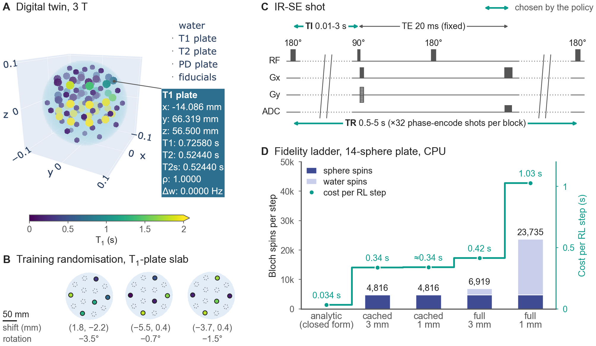
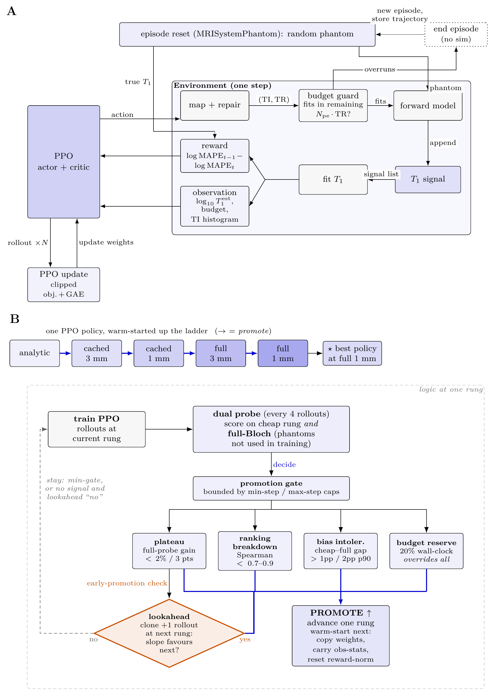
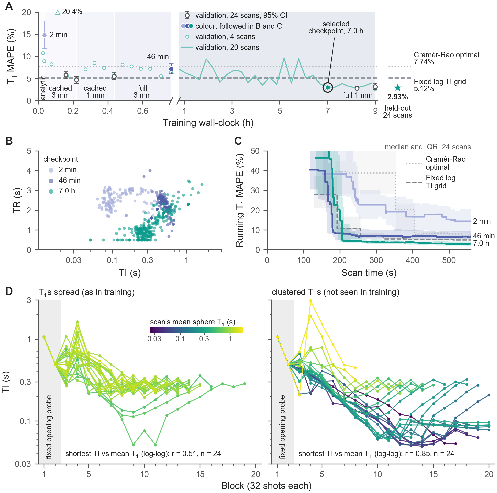
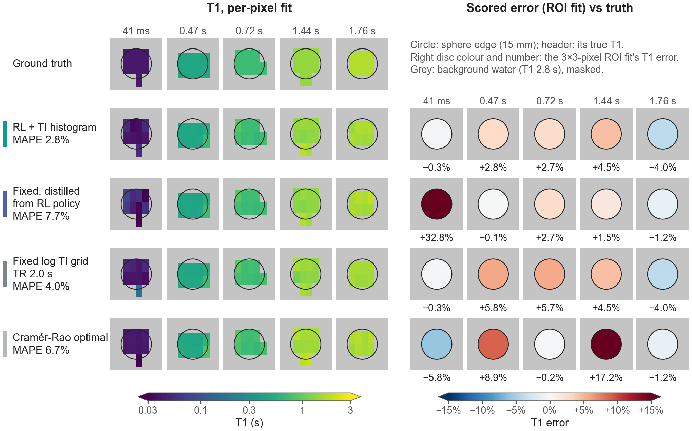
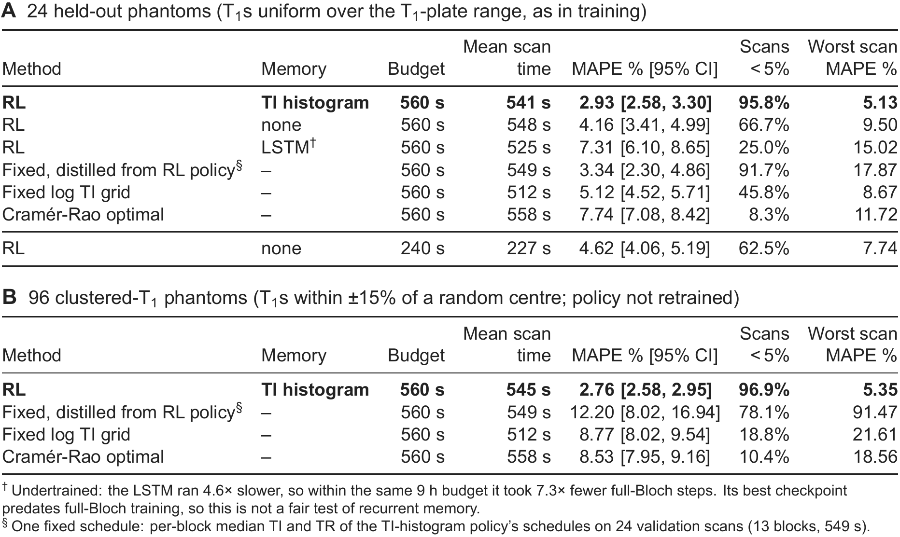
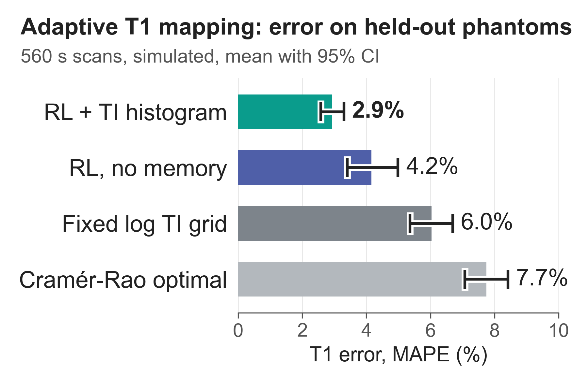

# ISMRM 2027 Standard Abstract - submission draft v2

Deadline: 28 Oct 2026, 23:59 UTC (ECHO).
Supersedes `submission.md`: new framing after the 22 Oct control experiment (RL as protocol discovery, adaptation as robustness), five figures, corrected numbers.
Sources for every number: `figures_plan.md` (corrections and control sections), `figures/control_summary.md`, `figures/fig5_table_v3.md`, `figures/control_narrow_band.md`.

## Title (max 125 characters)

Reinforcement learning using a digital twin of the ISMRM/NIST phantom learns more accurate T1 mapping protocols

## Authors

Arthur Allilaire (1), Magali Nuixe (2), Wayne Luk (1), Andreas Wetscherek (2).
(1) Department of Computing, Imperial College London, London, UK.
(2) Joint Department of Physics, The Institute of Cancer Research and The Royal Marsden NHS Foundation Trust, London, UK.
Presenting author: Andreas Wetscherek.

## Categories and keywords

- Primary: Acquisition & Reconstruction / AI methods (101).
- Secondary: Acquisition & Reconstruction / Quantitative Imaging: Relaxometry, Multi-Parametric, MR Fingerprinting, & Synthetic MRI (114).
- Alternative secondary: Open Source Software, Sequences, & Reconstruction Algorithms (119), or Physics & Engineering / In Silico (1305).
- General keyword: Simulations.
- Extra keywords: Quantitative, Relaxation, Phantom, Precision & Accuracy.

## Impact (max 40 words)

An open-source, KomaMRI-based digital twin of a calibration phantom lets reinforcement learning design quantitative MRI protocols before scanning. Learned sequences nearly halved T1 error versus standard designs. Adapting mid-scan helps most when tissue T1 is a narrow range.

## Synopsis (max 100 words across the four parts)

**Motivation:** Quantitative MRI protocols fix their timings in advance, spending scan time on uninformative measurements.

**Goal(s):** To test whether reinforcement learning (RL), trained in a digital twin of a calibration phantom, designs better T1 mapping acquisitions than fixed protocols.

**Approach:** We built an open-source Bloch-simulated twin of the phantom with multi-fidelity forward models and trained policies that choose each inversion and repetition time from the data acquired so far.

**Results:** On held-out phantoms the policy cut T1 error against log-spaced and Cramér-Rao-optimal schedules (2.9% versus 5.1% and 7.7%). A fixed protocol distilled from the adaptive policy kept most of the gain (3.3%).

## Body (max 750 words, references excluded)

### Introduction

The best inversion times (TIs) depend on the T1 being measured, so fixed T1 mapping protocols hedge across all plausible tissues. Instead, adaptive acquisition chooses each timing from the running estimate; simulations report 1.7-4x acceleration for a single voxel1. Reinforcement learning (RL) could learn such rules for several tissues at once, but in MRI it has so far designed fixed protocols before scanning2,3 or adapted acquisition for image reconstruction (using k-space sampling) or shape recognition4,5.
We built an open-source digital twin of a calibration phantom and trained the first RL agent to choose each TI and repetition time (TR) from the tissue estimates it is refining.

### Methods

**Digital twin.** MRISystemPhantom.jl models the ISMRM/NIST system phantom6 with manufacturer reference values at 1.5 and 3 T and returns KomaMRI7 phantoms (Fig 1A).
Random phantoms with hidden ground truth vary pose, sphere selection, and T1 and T2 from any chosen distribution (Fig 1B).
The package also provides inversion-recovery spin-echo (IR-SE) sequences (Fig 1C), complex Gaussian k-space noise, a grid-search T1 fitter (200 values, 2.9% apart) modelling incomplete recovery and a Cramér-Rao schedule solver.
Noise-free simulations recover reference T1 with 0.48% mean error.

**Task.** Each scan fills five T1-plate spheres with T1s drawn uniformly over the plate's T1 range (Fig 1B); 1.5 T, 64x32 matrix, 200 mm field of view, noise at peak NEMA SNR 25. Each action is one IR-SE block (Fig 1C); scans stop at 560 s.

**Agent.** A PPO8 policy observes the log T1 estimates, budget used and a 12-bin histogram of acquired TIs; its reward is $r_t=\log_{10}\mathrm{MAPE}_{t-1}-\log_{10}\mathrm{MAPE}_t$, with MAPE the mean absolute percentage error (Fig 2A). Ablations tried: no memory & an LSTM.

**Multi-fidelity training.** Full Bloch simulation costs about 0.1 s per block on our GPU, and each policy trains for ~300,000 blocks.
The water is homogeneous, so its k-space can be cached and scaled per shot, leaving only the sphere spins we measure to simulate (T1 within 0.12% of full Bloch).
One policy climbs a fidelity ladder from an analytic model to full Bloch (Fig 1D), warm-starting on cheap rungs before full-Bloch training (Figs 2B, 3A); 9 GPU hours per policy.

**Evaluation.** We tested on 24 held-out phantoms from the training distribution and on 96 clustered-T1 phantoms from a new distribution: five T1s within ±15% of a log-uniform centre.
Fixed comparators were a log-spaced TI grid (TR 2.0 s, best of a held-out TR sweep) and a Cramér-Rao-optimal (TI, TR) schedule9 for the plate's T1 range, with the same fitter and budget.
To separate adaptation from schedule shape, we swapped learned schedules between scans and distilled one fixed protocol from the policy's median TI and TR at each block on validation scans.

### Results

Training moved the policy to short TIs paired with short TRs (Fig 3A-C).
On held-out phantoms the TI-histogram policy reached 2.93% MAPE, against 5.12% for the best log grid and 7.74% for Cramér-Rao (Figs 4, 5A).
Without memory the policy reached 4.16%; with an LSTM, 7.31%.
With 240 s, an RL policy was more accurate (4.62%) than both fixed designs at 560 s.
Without adaptation most of the gain survived: distilled 3.34%, swapped schedules 3.61%.
Adaptation helped in the worst case (5.1% versus 8.7-17.9%; Fig 5A), rescuing two spheres of 41 and 46 ms that the distilled protocol missed by up to 74% (Fig 4).
Adaptation mattered more on clustered-T1 scans: swapping schedules cost 2.57 points [95% CI 1.21-4.24], mostly at short T1, versus 0.67 (not significant) on spread T1s, and fixed protocols reached 8.5-12.2% versus 2.76% (Figs 3D, 5B).

### Discussion

RL worked mainly as protocol discovery: short TRs, which the fitter's incomplete-recovery model permits, fit more blocks than either comparator.
Sequences acquiring several TIs or k-space lines per inversion exploit this further and are our next target.
Variance-optimal Cramér-Rao design did worst at this noise level.
A fixed schedule nearly matched the policy because each scan's spheres usually spanned most of the T1 range.
Adaptation paid off on rare short-T1 spheres and clustered T1s, so it should matter most when tissue T1 is narrow but unknown.
Limitations: simulation only (ideal RF, no B1, eddy currents or motion), one phantom, five spheres, one training seed per policy, one cluster width; the two-sphere effect is post hoc.

### Conclusion

RL in an open-source digital twin found a T1 protocol that nearly halves fixed-design error and runs as a conventional sequence; adapting each scan protects unusual tissue.
Next: validation on the physical phantom and T2 mapping.

## References

1. Beracha I, Seginer A, Tal A. Adaptive model-based magnetic resonance. Magn Reson Med. 2023;90(3):839-851. doi:10.1002/mrm.29688
2. Zheng T, Wang Z, Bray T, Alexander DC, Wu D, Zhang H. SCREENER: a general framework for task-specific experiment design in quantitative MRI. arXiv. 2024;2408.11834. doi:10.48550/arXiv.2408.11834
3. Zhong S, Chen Z, Chen Z. Optimize flip angle schedules in MR fingerprinting using reinforcement learning. arXiv. 2025;2511.19941. doi:10.48550/arXiv.2511.19941
4. Walker-Samuel S. Using deep reinforcement learning to actively, adaptively and autonomously control a simulated MRI scanner. Proc Intl Soc Mag Reson Med. 2019;27:0473.
5. Pineda L, Basu S, Romero A, Calandra R, Drozdzal M. Active MR k-space sampling with reinforcement learning. In: MICCAI 2020. Springer; 2020:23-33. doi:10.1007/978-3-030-59713-9_3
6. Russek SE, Boss MA, Charles HC, et al. MRI scanner characterization with the ISMRM/NIST system phantom. Proc Intl Soc Mag Reson Med. 2020;28:3384.
7. Castillo-Passi C, Coronado R, Varela-Mattatall G, Alberola-Lopez C, Botnar R, Irarrazaval P. KomaMRI.jl: an open-source framework for general MRI simulations with GPU acceleration. Magn Reson Med. 2023;90(1):329-342. doi:10.1002/mrm.29635
8. Schulman J, Wolski F, Dhariwal P, Radford A, Klimov O. Proximal policy optimization algorithms. arXiv. 2017;1707.06347. doi:10.48550/arXiv.1707.06347
9. Jones JA, Hodgkinson P, Barker AL, Hore PJ. Optimal sampling strategies for the measurement of spin-spin relaxation times. J Magn Reson B. 1996;113(1):25-34. doi:10.1006/jmrb.1996.0151

## Figures (captions max 500 characters)

### Figure 1

MRISystemPhantom.jl: open-source digital twin of the CaliberMRI QalibreMD Model 130, returning KomaMRI phantoms. (A) 3 T twin, spheres coloured by T1 (≥2 s saturates). (B) Three 1.5 T training phantoms, T1-plate slab: five spheres redrawn uniformly over 0.024-1.88 s, nine water (dotted), in-plane pose jitter. (C) IR-SE shot; the policy sets TI, TR per 32-shot block. (D) Bloch spins (bars), cost (line) per RL step; cached water: 3x cheaper than full Bloch. ≈: untimed, as cached 3 mm (same spins).

### Figure 2

Training loops. (A) Inner loop, one environment step: the PPO policy picks TI and TR for the next IR-SE block; if it fits the budget, the block is simulated at the current fidelity, T1 is refitted per sphere from all blocks so far, and the reward is the drop in log MAPE. (B) Outer loop: one policy is warm-started up the forward-model ladder (cached: precomputed water; 3 mm/1 mm: water grid), scored every 4 rollouts on the cheap rung and full-Bloch probes, and promoted when a trigger fires.

### Figure 3

TI-histogram policy over training, 24 validation phantoms unless stated. (A) T1 MAPE of each saved checkpoint, full Bloch (mean, bootstrap 95% CI); faint: logged probes; star, lines: selected checkpoint, fixed protocols on 24 held-out phantoms. (B) Executed (TI, TR) of coloured checkpoints: pairing short TIs with short TRs fits 13 blocks, not 7. (C) T1 MAPE within a scan (median, IQR); grey: fixed protocols. (D) Selected policy's TIs on spread and clustered-T1 scans, coloured by mean sphere T1.

### Figure 4

T1 maps of the held-out scan with the shortest sphere T1 of the 24 (41 ms), chosen to show where per-scan adaptation matters (representative errors: Fig 5A). Rows: TI-histogram policy (adaptive), a fixed protocol distilled from it (shortest TI 243 ms), fixed log TI grid (TR 2.0 s), Cramér-Rao. The policy moved its TIs down to 113 ms and measured the 41 ms sphere to 0.3%; the distilled protocol missed it by 33%. Left: per-pixel T1 fit; right: scored ROI error (3x3-pixel ROI fit) per sphere.

### Figure 5

T1 error on phantoms identical across methods, unseen in training or checkpoint selection: (A) 24 held-out; (B) 96 clustered-T1 (T1s within ±15% of a random centre). MAPE: mean absolute percentage error over a scan's spheres, averaged over scans (bootstrap 95% CI); worst: highest scan MAPE. Fixed grid: log-spaced TIs, TR 2.0 s (best of a 0.8-4 s sweep), top TI capped to fit. Cramér-Rao: optimised for the plate's T1 range. Distilled: policy's per-block median TI and TR. Same T1 fitter for all.

### Preview figure (no caption)

## Acknowledgements (not shown to reviewers)

- MRISystemPhantom.jl: https://github.com/ArthurAllilaire/MRISystemPhantom.jl (documentation: https://arthurallilaire.github.io/MRISystemPhantom.jl/dev/).
- Code to reproduce all results: https://github.com/ArthurAllilaire/RLxMRI.

## Limits check (delete before submission)

Counted by script on 24 Oct (whitespace words; superscript citations excluded): title 111/125 characters, impact 39/40 words, synopsis 97/100 words, body 747/750 words including the five section headings (742 without), captions 482-497/500 characters.
ECHO may count hyphenated tokens differently; re-check there and trim the Discussion first if it reports more than 750.

## Figure status (delete before submission)

| Figure | File | Status |
|---|---|---|
| 1 | `figures/fig1_v2_alt.png` | Done (twin, compact training slabs, generic IR-SE shot, fidelity ladder); `fig1_B1_shotreexport.png` is the previous version without the shot |
| 2 | `figures/fig2_loops_minimal_logicfix.png` | Done: original diagrams, minimal edits, lookahead logic corrected to match the code; `fig2_loops_minimal.png` keeps the original logic |
| 3 | `figures/fig3_combo_v3.png` | Done (training curve, superposed TI-TR of three checkpoints, within-scan MAPE with fixed comparators, TI per block on spread vs clustered-T1 scans); `fig3_combo.png` is the previous version with the sequence inset |
| 4 | `figures/fig4_t1maps_p7_roidiff_v2.png` | Done (held-out phantom 7, log T1 scale, flat scored-error discs on +/-15%; log grid at TR 2.0 s); `fig4_t1maps_p7_roidiff.png` is the TR 1.7 s grid version |
| 5 | `figures/fig5_table_v3.png` | Done (A: held-out table with distilled row and worst scan; B: clustered-T1 phantoms); `fig5_table_v2.png` is the single-table version |
| Preview | `figures/preview.png` | Done |

## Before submitting

- [ ] Merge https://github.com/ArthurAllilaire/MRISystemPhantom.jl/pull/1 (T2-plate T2 values corrected to the manual; all 1140 tests pass), since the body claims the manufacturer's reference values.
- [ ] Confirm Magali Nuixe's affiliation (listed as ICR, affiliation 2); co-author approval from all four authors.
- [ ] Reference 9 is a T2 sampling paper; replace with a T1 inversion-recovery Cramér-Rao design reference if one fits better.
- [ ] Final word and character counts in ECHO.
