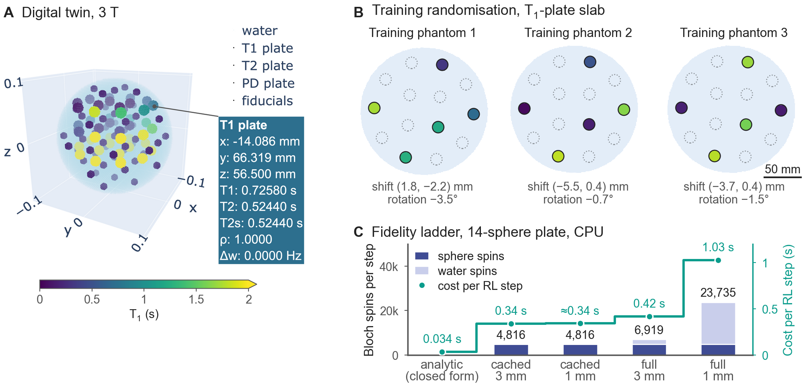
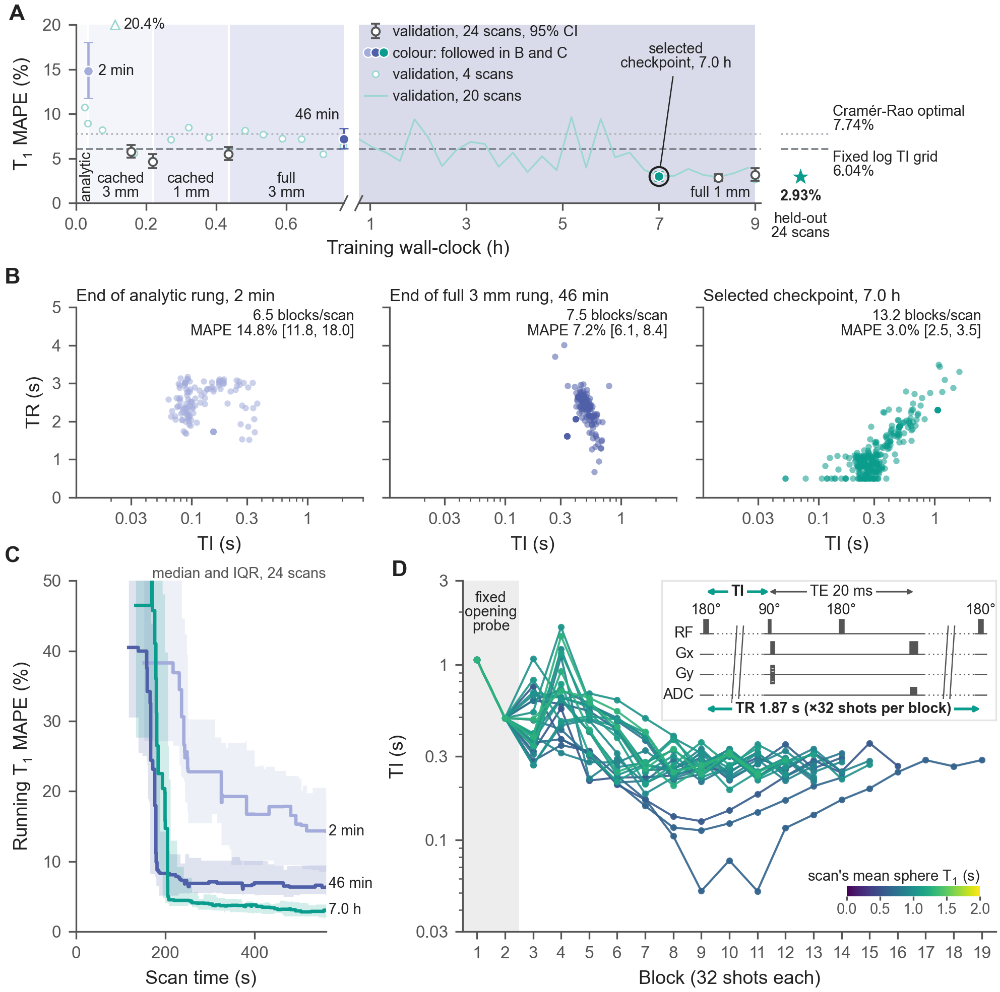
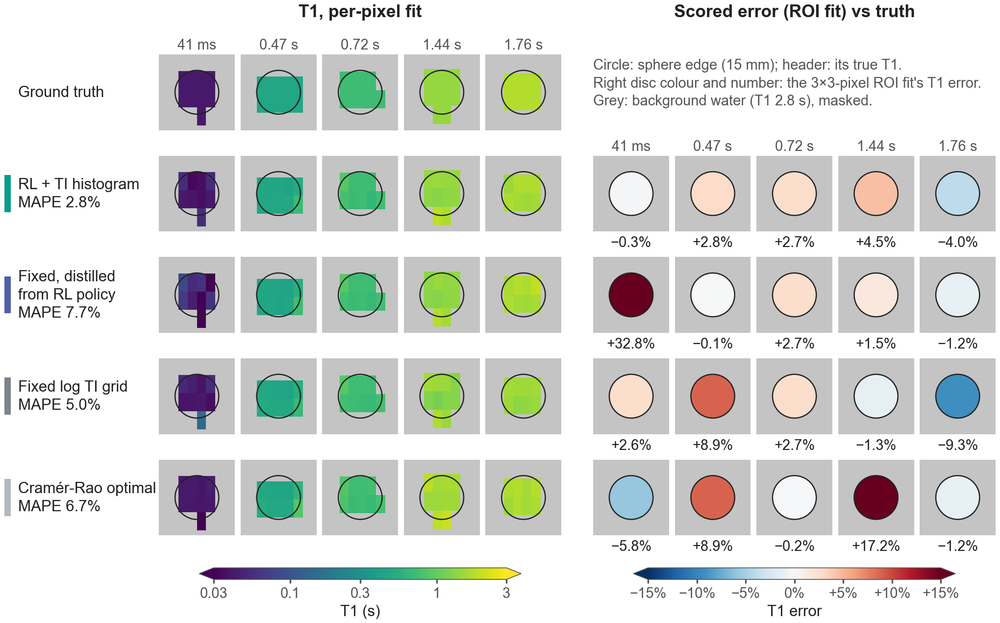
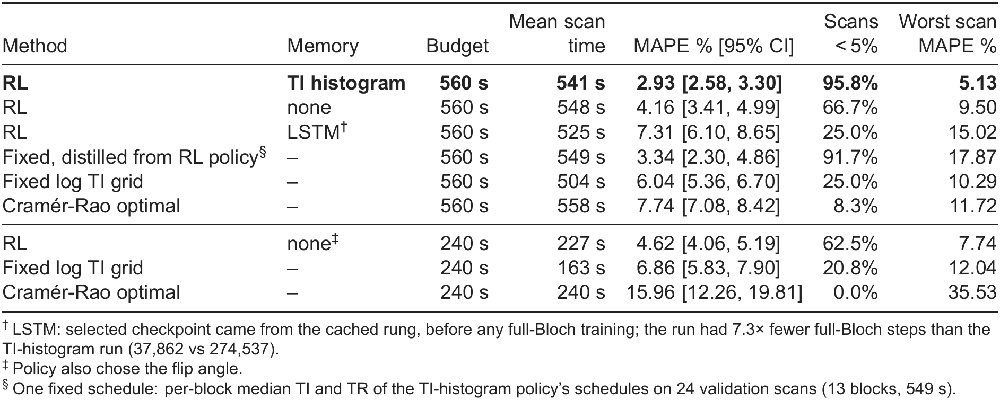

# ISMRM 2027 Standard Abstract - submission draft v2

Deadline: 28 Oct 2026, 23:59 UTC (ECHO).
Supersedes `submission.md`: new framing after the 22 Oct control experiment (RL as protocol discovery, adaptation as robustness), five figures, corrected numbers.
Sources for every number: `figures_plan.md` (corrections and control sections), `figures/control_summary.md`, `figures/fig5_table.md`.

## Title (max 125 characters)

Reinforcement learning using a digital twin of the ISMRM/NIST phantom discovers more accurate T1 mapping protocols

## Authors

Arthur Allilaire (1), Magali Nuixe (2), Wayne Luk (1), Andreas Wetscherek (2).
(1) Department of Computing, Imperial College London, London, UK.
(2) Joint Department of Physics, The Institute of Cancer Research and The Royal Marsden NHS Foundation Trust, London, UK.
Presenting author: Andreas Wetscherek.

## Categories and keywords

- Primary: Acquisition & Reconstruction / AI methods (101).
- Secondary: Acquisition & Reconstruction / Quantitative Imaging: Relaxometry, Multi-Parametric, MR Fingerprinting, & Synthetic MRI (114).
- Alternative secondary: Open Source Software, Sequences, & Reconstruction Algorithms (119), or Physics & Engineering / In Silico (1305).
- General keyword: Simulations.
- Extra keywords: Quantitative, Relaxation, Phantom, Precision & Accuracy.

## Impact (max 40 words)

An open-source, KomaMRI-based digital twin of the ISMRM/NIST phantom lets reinforcement learning design quantitative MRI protocols before scanning. Learned sequences halved T1 error versus standard designs. Adapting during the scan could protect accuracy for atypical tissue.

## Synopsis (max 100 words across the four parts)

**Motivation:** Quantitative MRI protocols fix their timings in advance, spending scan time on uninformative measurements.

**Goal(s):** To test whether reinforcement learning (RL), trained in a digital twin of a calibration phantom, designs better T1 mapping acquisitions than fixed protocols.

**Approach:** We built an open-source Bloch-simulated twin of the ISMRM/NIST phantom with multi-fidelity forward models and trained policies that choose each inversion and repetition time from the data acquired so far.

**Results:** On held-out phantoms the policy halved T1 error against log-spaced and Cramér-Rao-optimal schedules (2.9% versus 6.0% and 7.7%). A fixed protocol distilled from the adaptive policy kept most of the gain (3.3%).

## Body (max 750 words, references excluded)

### Introduction

The best inversion times (TIs) depend on the T1 being measured, so fixed T1 mapping protocols hedge across all plausible tissues. Instead, adaptive acquisition chooses each timing from the running estimate; simulations report 1.7-4x acceleration for a single voxel1. Reinforcement learning (RL) could learn such rules for several tissues at once, but in MRI it has so far designed fixed protocols before scanning2,3 or adapted acquisition for image reconstruction (using k-space sampling) or shape recognition4,5.
We built an open-source digital twin of a calibration phantom and trained the first RL agent to choose each TI and repetition time (TR) from the tissue estimates it is refining.

### Methods

**Digital twin.** MRISystemPhantom.jl models the ISMRM/NIST system phantom6 with its T1, T2 and proton-density plates and manufacturer reference values at 1.5 and 3 T, and returns KomaMRI7 phantoms (Fig 1A).
It samples random phantoms with hidden ground truth (pose, sphere subsets, and T1 and T2 from user-set distributions; Fig 1B), adds complex Gaussian k-space noise, and provides 2D inversion-recovery spin-echo (IR-SE) sequences, reconstruction, a T1 fitter modelling incomplete recovery, and a Cramér-Rao schedule solver.
Noise-free simulations recover reference T1 with 0.48% mean error.

**Task.** Each scan draws five T1-plate sphere T1s uniformly over 0.024-1.88 s and jitters the pose; 1.5 T, 64x32 matrix, 200 mm field of view, noise at NEMA dual-acquisition SNR 25 (brightest sphere).
Each action is one IR-SE block of 32 phase-encode shots with TI 0.01-3 s and TR 0.5-5 s (TE 20 ms, 90°); scans stop at 560 s.
T1 is refitted per sphere after every block.

**Agent.** A PPO8 policy observes the log T1 estimates, budget used and a 12-bin histogram of acquired TIs; the reward is the per-block drop in log mean absolute percentage error (MAPE) (Fig 2A).
Alternatives: no memory or an LSTM.

**Multi-fidelity training.** Full Bloch simulation costs about 1 s per block.
Because simulation is linear in spins and the water homogeneous, the water's k-space is a per-shot scalar times a fixed template; caching it leaves only sphere spins to simulate (T1 within 0.12% of full Bloch).
One policy climbs from an analytic model through cached and coarse water to full Bloch (Fig 1C), promoted on full-Bloch probes (Fig 2B); 9 h on one GPU per arm.

**Evaluation.** All methods shared 24 held-out phantoms unseen in training or checkpoint selection.
Comparators were a log-spaced TI grid (TR 1.7 s) and a Cramér-Rao-optimal (TI, TR) schedule9 for the plate's T1 range, with the same fitter and budget.
To separate adaptation from schedule shape, we gave each phantom another scan's learned schedule, and distilled one fixed protocol from the per-block median TI and TR of the policy's validation schedules.

### Results

Training moved the policy from few long-TR blocks to short TIs paired with short TRs (Fig 3A-C); scans share a two-block opening, then diverge (Fig 3D).
On held-out phantoms the TI-histogram policy reached 2.93% MAPE [95% CI 2.58-3.30], against 6.04% [5.36-6.70] for the log grid and 7.74% [7.08-8.42] for Cramér-Rao, with 96% versus 25% and 8% of scans below 5% error (Figs 4, 5).
Without memory the policy reached 4.16%; with an LSTM, 7.31%.
Tripling the grid's scan time (163 to 504 s) reduced its error only from 6.86% to 6.04%.
Most of the gain survived without adaptation: the distilled protocol reached 3.34% [2.30-4.86] and swapped schedules 3.61% [3.01-4.45].
Adaptation showed in the worst case (5.1% versus 10.3-17.9% for the fixed schedules): the policy's shortest TI tracked the phantom's shortest T1 (r = 0.57), rescuing two spheres of 41 and 46 ms that the distilled protocol missed by up to 74%.

### Discussion

Closed-loop RL worked mainly as protocol discovery: the learned schedule acquires more blocks than either comparator (12.5 versus 9-10) by keeping TR short unless TI is long.
The Cramér-Rao schedule, optimal for an unbiased estimator's variance, did worst at this noise level and block count.
Because each scan's five spheres usually spanned most of the T1 range, one schedule suited most scans; per-scan adaptation paid off only for rare outliers, adding robustness rather than mean accuracy.
Limitations: simulation only (ideal RF, no B1, eddy currents or motion), one phantom, five spheres, one seed per arm, 24 held-out scans; the two-sphere effect is post hoc.

### Conclusion

RL in an open-source digital twin found a T1 protocol halving the error of established fixed designs; distilled, it runs as a conventional sequence, with the adaptive policy safeguarding unusual tissue.
Next: validation on the physical phantom and T2 mapping.

## References

1. Beracha I, Seginer A, Tal A. Adaptive model-based magnetic resonance. Magn Reson Med. 2023;90(3):839-851. doi:10.1002/mrm.29688
2. Zheng T, Wang Z, Bray T, Alexander DC, Wu D, Zhang H. SCREENER: a general framework for task-specific experiment design in quantitative MRI. arXiv. 2024;2408.11834. doi:10.48550/arXiv.2408.11834
3. Zhong S, Chen Z, Chen Z. Optimize flip angle schedules in MR fingerprinting using reinforcement learning. arXiv. 2025;2511.19941. doi:10.48550/arXiv.2511.19941
4. Walker-Samuel S. Using deep reinforcement learning to actively, adaptively and autonomously control a simulated MRI scanner. Proc Intl Soc Mag Reson Med. 2019;27:0473.
5. Pineda L, Basu S, Romero A, Calandra R, Drozdzal M. Active MR k-space sampling with reinforcement learning. In: MICCAI 2020. Springer; 2020:23-33. doi:10.1007/978-3-030-59713-9_3
6. Russek SE, Boss MA, Charles HC, et al. MRI scanner characterization with the ISMRM/NIST system phantom. Proc Intl Soc Mag Reson Med. 2020;28:3384.
7. Castillo-Passi C, Coronado R, Varela-Mattatall G, Alberola-Lopez C, Botnar R, Irarrazaval P. KomaMRI.jl: an open-source framework for general MRI simulations with GPU acceleration. Magn Reson Med. 2023;90(1):329-342. doi:10.1002/mrm.29635
8. Schulman J, Wolski F, Dhariwal P, Radford A, Klimov O. Proximal policy optimization algorithms. arXiv. 2017;1707.06347. doi:10.48550/arXiv.1707.06347
9. Jones JA, Hodgkinson P, Barker AL, Hore PJ. Optimal sampling strategies for the measurement of spin-spin relaxation times. J Magn Reson B. 1996;113(1):25-34. doi:10.1006/jmrb.1996.0151

## Figures (captions max 500 characters)

### Figure 1

MRISystemPhantom.jl: open-source digital twin of the ISMRM/NIST system phantom (CaliberMRI QalibreMD Model 130) returning KomaMRI phantoms. (A) Twin at 3 T, spheres coloured by T1 (≥2 s saturates). (B) T1-plate slab of three 1.5 T training phantoms: five spheres redrawn uniformly over 0.024-1.88 s, the other nine positions (dotted) water, pose jittered in-plane. (C) Bloch spins (bars) and cost (line) per RL step; cached water makes a step 3x cheaper than full Bloch. ≈: not timed on CPU.

### Figure 2

Training loops. (A) Inner loop, one environment step: the PPO policy picks TI and TR for the next IR-SE block; if it fits the budget, the block is simulated at the current fidelity, T1 is refitted per sphere from all blocks so far, and the reward is the drop in log MAPE. (B) Outer loop: one policy is warm-started up the forward-model ladder (cached: precomputed water; 3 mm/1 mm: water grid), scored every 4 rollouts on the cheap rung and full-Bloch probes, and promoted when a trigger fires.

### Figure 3

TI-histogram policy over training, 24 validation phantoms unless stated. (A) T1 MAPE of every saved checkpoint, full Bloch (mean, bootstrap 95% CI); faint: logged probes; star and lines: selected checkpoint and fixed protocols, 24 held-out phantoms. Coloured: checkpoints followed in B and C. (B) Executed (TI, TR): pairing short TIs with short TRs fits 13 blocks, not 7. (C) T1 MAPE within a scan (median, IQR). (D) Selected policy's TI per block, coloured by mean sphere T1; inset: one IR-SE shot.

### Figure 4

T1 maps of the held-out scan with the shortest sphere T1 of the 24 (41 ms), chosen to show where per-scan adaptation matters (representative errors: Fig 5). Rows: TI-histogram policy (adaptive), a fixed protocol distilled from it (shortest TI 243 ms), fixed log TI grid, Cramér-Rao. The policy moved its TIs down to 113 ms and measured the 41 ms sphere to 0.3%; the distilled protocol missed it by 33%. Left: per-pixel T1 fit; right: scored ROI error (3x3-pixel ROI fit) per sphere.

### Figure 5

T1 error on 24 held-out random phantoms, identical for every method and never used for training or checkpoint selection. MAPE: mean absolute percentage error over five spheres, averaged over scans (bootstrap 95% CI); <5%: share of scans under 5%; worst: highest scan MAPE. Fixed grid: log-spaced TIs, TR 1.7 s. Cramér-Rao: schedule optimised for the plate's T1 range. Distilled: per-block median TI and TR of the RL policy. Same T1 fitter throughout. †LSTM checkpoint predates full-Bloch training.

### Preview figure (no caption)

## Acknowledgements (not shown to reviewers)

- MRISystemPhantom.jl: https://github.com/ArthurAllilaire/MRISystemPhantom.jl (documentation: https://arthurallilaire.github.io/MRISystemPhantom.jl/dev/).
- Code to reproduce all results: https://github.com/ArthurAllilaire/RLxMRI.

## Limits check (delete before submission)

Counted by script on 24 Oct (whitespace words; superscript citations excluded): title 111/125 characters, impact 39/40 words, synopsis 97/100 words, body 747/750 words including the five section headings (742 without), captions 482-497/500 characters.
ECHO may count hyphenated tokens differently; re-check there and trim the Discussion first if it reports more than 750.

## Figure status (delete before submission)

| Figure | File | Status |
|---|---|---|
| 1 | `figures/fig1_B1_shotreexport.png` | Done (3 T viewer look, legible, shared T1 scale; two-axis ladder with linear cost axis) |
| 2 | `figures/fig2_loops_minimal_logicfix.png` | Done: original diagrams, minimal edits, lookahead logic corrected to match the code; `fig2_loops_minimal.png` keeps the original logic |
| 3 | `figures/fig3_combo.png` | Done (training curve with 24-scan CIs for every checkpoint, TI-TR at three checkpoints, within-scan MAPE, TI per block with sequence inset); `fig3_ci.png` is the simpler alternative |
| 4 | `figures/fig4_t1maps_p7_roidiff.png` | Done (held-out phantom 7, log T1 scale, flat scored-error discs on +/-15%); `fig4_t1maps_p7.png` has per-pixel difference maps instead |
| 5 | `figures/fig5_table_v2.png` | Done (distilled row, worst-scan column; fixed comparators re-run locally and reproduce the recorded results exactly) |
| Preview | `figures/preview.png` | Done |

## Before submitting

- [ ] Merge https://github.com/ArthurAllilaire/MRISystemPhantom.jl/pull/1 (T2-plate T2 values corrected to the manual; all 1140 tests pass), since the body claims the manufacturer's reference values.
- [ ] Confirm Magali Nuixe's affiliation (listed as ICR, affiliation 2); co-author approval from all four authors.
- [ ] Reference 9 is a T2 sampling paper; replace with a T1 inversion-recovery Cramér-Rao design reference if one fits better.
- [ ] Final word and character counts in ECHO.
